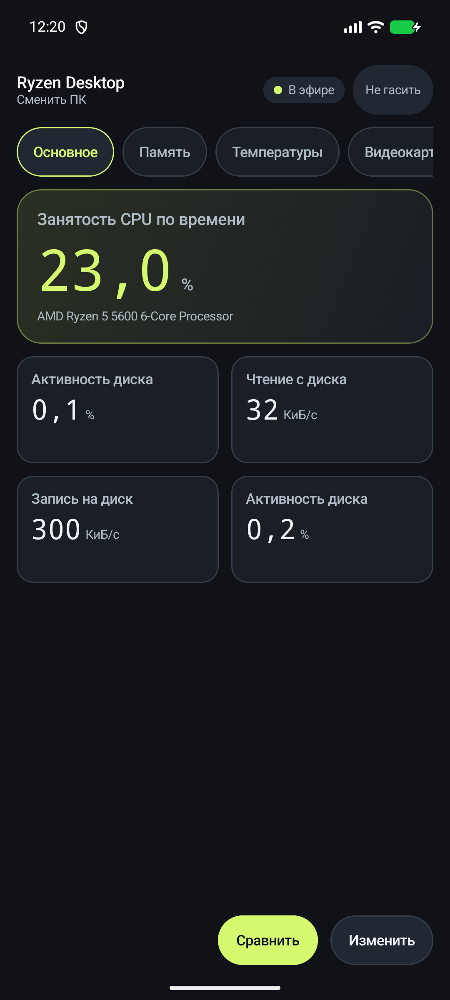
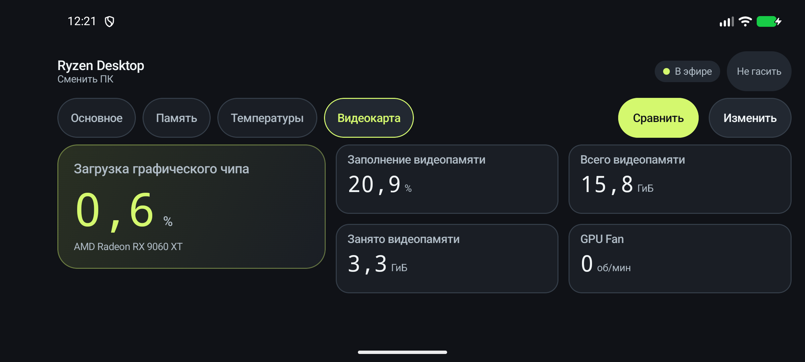

# HardwareDisplay

**Телефон как второй экран датчиков Windows-ПК.** Поставьте его рядом с монитором, чтобы видеть загрузку процессора и видеокарты, память, температуры и активность дисков во время игры или рендера.

## Скачать предварительную сборку

| Платформа | Файл | Для кого |
| --- | --- | --- |
| Windows 11 x64 | [EXE · 86 МиБ](https://github.com/OlehHavrilko/hwredisplay/releases/download/v0.1.0-preview.1/HardwareDisplay-win-x64.exe) | Портативный хост со встроенным .NET |
| Android 8.0+ · ARM64 | [APK · 8 МиБ](https://github.com/OlehHavrilko/hwredisplay/releases/download/v0.1.0-preview.1/HardwareDisplay-android-arm64-v8a.apk) | Большинство телефонов, включая Poco X5 Pro 5G |
| Android 8.0+ · ARMv7 / x86_64 | [Все сборки](https://github.com/OlehHavrilko/hwredisplay/releases/tag/v0.1.0-preview.1) | 32-битные ARM-устройства и эмулятор |

Это предварительный выпуск. APK подписан отладочным ключом, EXE без цифровой подписи. Сквозной сценарий проверен с реальным ПК и эмулятором Android 17. [Примечания к выпуску и SHA-256](https://github.com/OlehHavrilko/hwredisplay/releases/tag/v0.1.0-preview.1)

## Панель

<p align="center">
  
  
</p>

- **Показания в реальном времени.** CPU, RAM, GPU, VRAM, диски и доступные на ПК температуры и обороты вентиляторов.
- **Своя раскладка.** Выберите пресет, назначьте главный датчик и переключите карточку с числа на график. В альбомной ориентации дополнительные датчики расположены в две колонки.
- **История и сравнение.** Сравнивайте ряды за 5, 15 или 60 минут. При обрыве связи панель показывает время последнего замера.
- **Локальное подключение.** Windows-хост работает в трее и отправляет телеметрию через защищённый WebSocket в локальной сети. Аккаунт не требуется.

## Первый запуск

1. Запустите EXE на ПК и установите подходящий APK на телефон.
2. Подключите устройства к одной локальной сети. Если Windows запросит сетевой доступ, разрешите его для частной сети.
3. Откройте настройки хоста из трея. На телефоне отсканируйте QR-код или перенесите данные приглашения вручную.

## Сборка из исходников

Для Windows нужен .NET SDK из [global.json](global.json). Android-проект открывается в Android Studio из каталога `android/`. Исходники Android используют SDK API 37 и Java 17.

```powershell
. .\scripts\dev-env.ps1
dotnet build HardwareDisplay.slnx
dotnet test windows\tests\HardwareDisplay.Tests
.\android\gradlew.bat -p android :app:assembleDebug :app:testDebugUnitTest :app:lintDebug
```

APK по архитектурам находятся в `android/app/build/outputs/apk/debug/`. Для эмулятора x86_64 используйте `app-x86_64-debug.apk`.

[Документация](docs/README.md) · [Android-клиент](docs/ANDROID_CLIENT.md) · [Windows-хост](docs/HOST_DESKTOP.md) · [Протокол](docs/PROTOCOL.md) · [План развития](docs/IMPLEMENTATION_PLAN.md)
