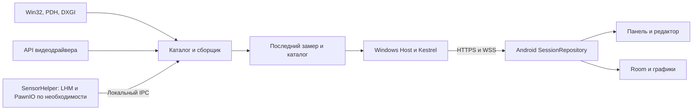

# Архитектура HardwareDisplay

Предлагаемая связка для прототипа — C#/.NET 10 и WPF + ASP.NET Core/Kestrel на Windows, Kotlin + Jetpack Compose на Android, OkHttp для HTTPS/WSS, Room и DataStore для локальных данных. Первая проверка целится в Windows 11 x64 и физические Android-устройства. Минимальный и целевой Android SDK утверждаются по итогам прототипа, включая проверку разрешений LAN. [Kestrel](https://learn.microsoft.com/en-us/aspnet/core/fundamentals/servers/kestrel/endpoints?view=aspnetcore-10.0) · [Android architecture](https://developer.android.com/topic/architecture) · [Local network permission](https://developer.android.com/privacy-and-security/local-network-permission)

## Windows и граница прав

- `Host` показывает подключённые телефоны, запуск/остановку LAN, фактический IP/порт, состояние каждого источника и пару QR/ручной ввод. Сбор и Kestrel продолжаются при сворачивании. Старт с Windows и служба остаются возможными итерациями. WPF и сетевой код работают под текущим пользователем с обычными правами.
- `Core` хранит каталог, расписание и нормализованные замеры. Контракт провайдера описывает инвентарь, опрос и диагностику группы. Быстрые источники стартуют с интервалом 1 с. SMART и другие тяжёлые группы получают собственное расписание, стартовый ориентир 5–10 с. По каждому источнику максимум одна незавершённая операция. При дедлайне быстрый поток продолжает работу со статусом отказавшей группы. Если вызов невозможно прервать, зависший провайдер не запускается поверх прежнего, а внешнему helper можно завершить процесс и применить backoff.
- `Windows` содержит штатные провайдеры и подключаемые адаптеры API драйверов. Метрика хранит источник и смысл, поэтому смена провайдера с другой семантикой создаёт другой датчик. Значения получают по фактической возможности оборудования и текущим правам. До проверки GPU/VRAM считаются кандидатами на покрытие.
- `SensorHelper` — опциональный процесс для LHM-групп, которым нужны дополнительные права. Локальный named pipe с явным ACL ожидаемого пользователя и запретом удалённых клиентов передаёт только версионированный каталог и измерения. Помощник не принимает команды управления железом, сетевые токены и произвольные обращения к драйверу. Сначала испытать LHM под обычным пользователем, запуск с повышением нужен только для групп, которым оно требуется. [Named pipe security](https://learn.microsoft.com/en-us/windows/win32/ipc/named-pipe-security-and-access-rights)
- LHM использует изолированные чистые `ISettings`. Стартовое состояние управления остаётся `Undefined`. Импорт сохранённых режимов управления из внешних программ и вызовы `IControl` исключены. В теге `v0.9.6` AMD GPU содержит ветки установки вентилятора, поэтому проверка этой границы нужна даже при использовании библиотеки для чтения. Обычная установка PawnIO сохраняет штатный ACL, Secure Boot, HVCI и Defender. Встроенные контроллеры платы включаются только после отдельного прогона. [LHM Control](https://github.com/LibreHardwareMonitor/LibreHardwareMonitor/blob/v0.9.6/LibreHardwareMonitorLib/Hardware/Control.cs) · [AMD GPU](https://github.com/LibreHardwareMonitor/LibreHardwareMonitor/blob/v0.9.6/LibreHardwareMonitorLib/Hardware/Gpu/AmdGpu.cs) · [PawnIO ACL](https://github.com/namazso/PawnIO.Setup/issues/12)

### Семантика провайдеров

| Метрика | Предлагаемый источник и поведение |
| --- | --- |
| CPU busy | Win32 `GetSystemTimes`, два замера. Kernel включает idle. `100 × (Δkernel + Δuser − Δidle) / (Δkernel + Δuser)`. При нулевом знаменателе или сбросе ожидать новую пару. На системах с несколькими processor groups испытать PDH как отдельный вариант. [Microsoft](https://learn.microsoft.com/en-us/windows/win32/api/processthreadsapi/nf-processthreadsapi-getsystemtimes) |
| RAM | `GlobalMemoryStatusEx`, `ullTotalPhys − ullAvailPhys`, ёмкость и процент. Commit и установленные модули — другие метрики. [Microsoft](https://learn.microsoft.com/en-us/windows/win32/api/sysinfoapi/ns-sysinfoapi-memorystatusex) |
| Активность GPU | Проверить PDH `GPU Engine` на реальных WDDM-драйверах. Группировать вклад PID по адаптеру и движку, проверить агрегирование вклада одного движка и максимум среди движков при отдельных 3D/compute/decode нагрузках. AMD/NVIDIA/Intel могут сообщать иной `core busy`, сохранять это как отдельную семантику. [Microsoft DirectX](https://devblogs.microsoft.com/directx/gpus-in-the-task-manager/) |
| Dedicated и shared память GPU | Проверить адаптерные PDH `GPU Adapter Memory` и ёмкость DXGI. `IDXGIAdapter3::QueryVideoMemoryInfo` описывает бюджет и использование приложения. Не складывать process-level counters. Для UMA с отсутствующей применимой dedicated capacity показывать отдельные доступные метрики без процента заполнения VRAM. [DXGI](https://learn.microsoft.com/en-us/windows/win32/api/dxgi1_4/ns-dxgi1_4-dxgi_query_video_memory_info) · [Process counters](https://learn.microsoft.com/en-us/troubleshoot/windows-client/performance/gpu-process-memory-counters-report-wrong-value) |
| Физические диски | PDH `PhysicalDisk`, чтение/запись в байтах/с и явно определённое время активности. Устройство сопоставляется с физическим диском, агрегат `_Total` получает отдельную семантику. Температура/здоровье идут отдельно из поддерживаемого storage provider. [Счётчики дисков](https://learn.microsoft.com/en-us/windows-server/storage/storage-spaces/performance-history-for-drives) · [NVMe](https://learn.microsoft.com/en-us/windows/win32/fileio/working-with-nvme-devices) |
| Температуры, частоты, питание, вентиляторы | LHM `0.9.6` как кандидат. На AMD проверить ADLX при пробеле покрытия, на NVIDIA — NVML/NVAPI, на Intel — IGCL. Имена `CPU Package`, `Tctl`, `Tdie`, `GPU Temperature`, `Hotspot` и температура памяти сохраняют свою точку измерения. Нагрузка контроллера VRAM отделена от объёма занятой VRAM. [LHM](https://github.com/LibreHardwareMonitor/LibreHardwareMonitor/releases/tag/v0.9.6) · [ADLX](https://gpuopen.com/manuals/adlx/adlx-sdk-references/adlx-interfaces/performance-monitoring/iadlxgpumetrics/) · [NVML](https://docs.nvidia.com/deploy/nvml-api/latest/api/structnvmlUtilization__t.html) · [IGCL](https://github.com/intel/drivers.gpu.control-library) |

ПК хранит стабильный `deviceId` и связывает его с доступным PnP/vendor-идентификатором. LUID используется только для сопоставления источников текущего сеанса Windows. Сырые серийные номера и PID не нужны телефону. При двух одинаковых GPU или неоднозначности сопоставления интерфейс предлагает новую привязку. Постоянный `sensorId` соответствует сочетанию экземпляра устройства, семантики и стабильного ключа провайдера. Ярлык устройства может измениться без потери истории. Локализованные имена Windows-счётчиков требуют корректной обработки PDH `PdhAddEnglishCounterW`, wildcard и статуса каждой строки. [LUID](https://learn.microsoft.com/en-us/windows/win32/api/d3d12/nf-d3d12-id3d12device-getadapterluid) · [PDH](https://learn.microsoft.com/en-us/windows/win32/api/pdh/nf-pdh-pdhaddenglishcounterw)

## LAN, жизненный цикл и диагностика

Windows по действию пользователя привязывает Kestrel к выбранному IPv4 и порту. Интерфейс показывает конфликт порта, изменившийся IP и профиль сети. Правило установщика ограничивается путём EXE, TCP-портом, профилем `Private` и `LocalSubnet`, при необходимости адресом/адаптером. Действия обновления и удаления затрагивают правило HardwareDisplay. Изоляция клиентов в Wi‑Fi, VPN и несколько адаптеров могут потребовать ручного выбора маршрута. Изменение IP приводит к повторному bind и обновлению адреса на телефоне. Проверка личности, токены и контракты описаны в [PROTOCOL.md](PROTOCOL.md). [Windows Firewall](https://learn.microsoft.com/en-us/windows/security/operating-system-security/network-security/windows-firewall/rules)

Android держит один `SessionRepository` для активного ПК. Экран Compose получает состояние через `ViewModel` и `StateFlow`. Поворот экрана и навигация между панелью, настройками и историей сохраняют сессию, а уход приложения в фон завершает её для v1. Возврат инициирует reconnect и новый сегмент истории. `ConnectivityManager` сигнализирует о смене сети. Диагностика показывает последний фактический замер и действия при отсутствии разрешения, маршрута, доверия и прав на ПК. На Android 17 при target SDK ≥37 прямой доступ к LAN требует `ACCESS_LOCAL_NETWORK`. Разрешение камеры запрашивается в QR-сценарии. Ручной ввод работает без камеры. При отказе LAN-разрешения клиент не пытается соединиться снова без действия пользователя. [LAN permission](https://developer.android.com/privacy-and-security/local-network-permission) · [ConnectivityManager](https://developer.android.com/develop/connectivity/network-ops/reading-network-state)

## Android-панель и данные

- Основной экран даёт быстрый выбор пресета, индикатор соединения и карточки числа, индикатора или мини-графика. При отсутствии подходящего датчика карточка сохраняет место, выводит причину и открывает подбор. В редакторе пользователь добавляет доступные датчики по компоненту, меняет порядок, ширину и тип карточки. Проверь портрет, альбомную ориентацию, тёмную тему, крупный шрифт и управление доступностью.
- Пресет хранит карточки с порядком, размером и видом, ссылку на главную карточку и до двух дополнительных датчиков сравнения. Привязка сохраняет `(hostId, sensorId)` и отдельно `metricKey`/тип устройства для подсказки на другом ПК. Неоднозначный выбор подтверждает пользователь. Стартовые пресеты используют обнаруженные метрики CPU, GPU, VRAM и RAM и показывают отсутствие поддержки там, где это важно.
- Room хранит ПК, пресеты, карточки и историю. DataStore хранит активный ПК, выбранный пресет, режим экрана и обычные настройки. Bearer и pending-учётные данные хранятся отдельно через Keystore. Для первой итерации история хранит последний час для максимум 24 отмеченных датчиков на активном ПК, общий лимит — 100 000 точек. Запись батчами каждые 5 секунд, при превышении лимита удаляются старейшие точки. При 24 датчиках и 1 Гц получится до 86 400 записей за час до учёта пропусков. Проверить размер базы с WAL и стоимость батчей на телефоне. [Room](https://developer.android.com/training/data-storage/room) · [DataStore](https://developer.android.com/topic/libraries/architecture/datastore)
- История показывает интервал, единицы, min/max валидных точек и время выбранного замера. В сравнении до трёх рядов используют общий курсор времени и отдельные шкалы. Рендер ограничивает число точек на экран с сохранением экстремумов и границ непрерывности. Кнопка «Не гасить экран» действует только на открытой панели. По состоянию ошибки пользователь видит последнее значение отдельно от текущего замера. Компоновку и взаимодействия определяет [дизайн HardwareDisplay](DESIGN.md).

## Поставка и лицензионная проверка

Для первого стенда собрать Windows x64 `.exe` и Android APK. После проверки поставки выбрать self-contained режим Windows, поведение установщика, канал обновления, подпись и целевые версии платформ. До публикации проверить фактический `publish` и цепочку зависимостей, составить SBOM и уведомления, зафиксировать версии и доступ к исходной форме компонентов с такими требованиями. LHM распространяется под MPL‑2.0, его пакет содержит сторонние компоненты с отдельными условиями. Совместимость PawnIO и условия включения установщика проверяются отдельно. Первый прототип может использовать установленный пользователем официальный PawnIO. [LHM notices](https://github.com/LibreHardwareMonitor/LibreHardwareMonitor/blob/v0.9.6/THIRD-PARTY-NOTICES.txt) · [MPL‑2.0 §3](https://www.mozilla.org/en-US/MPL/2.0/) · [PawnIO](https://github.com/namazso/PawnIO/blob/2.2.0/README.md)
